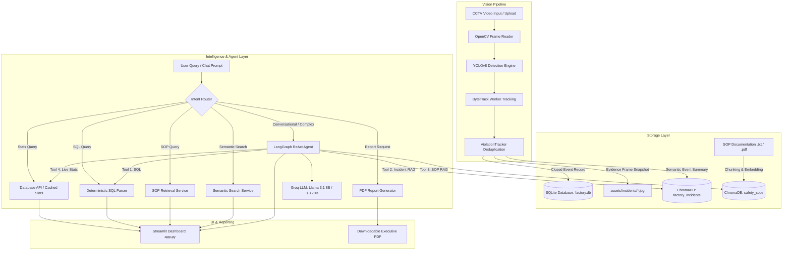
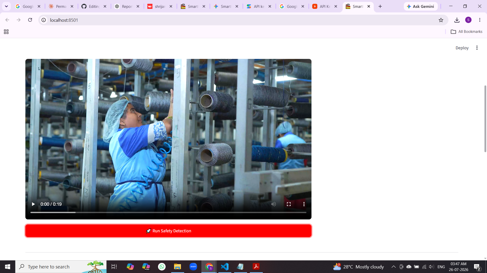
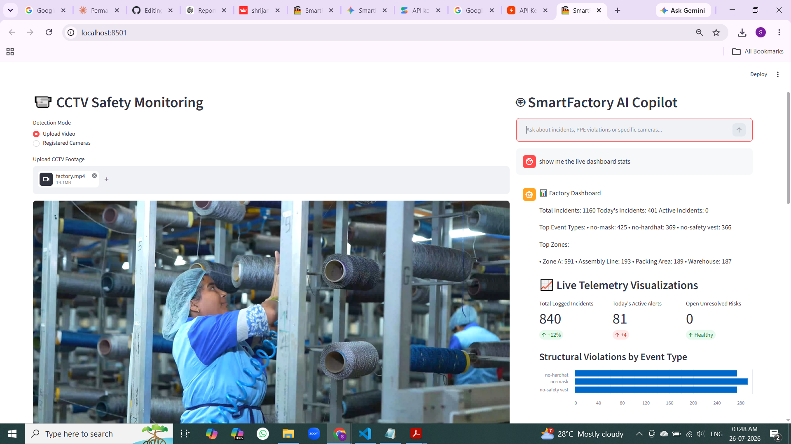
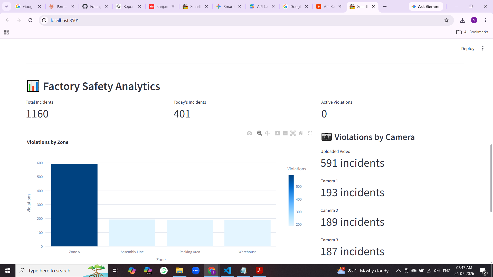
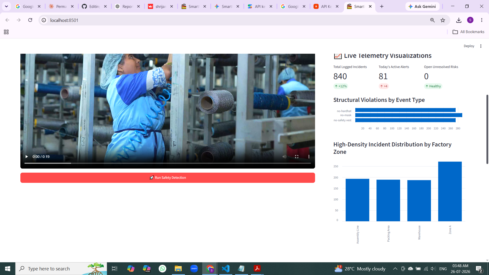
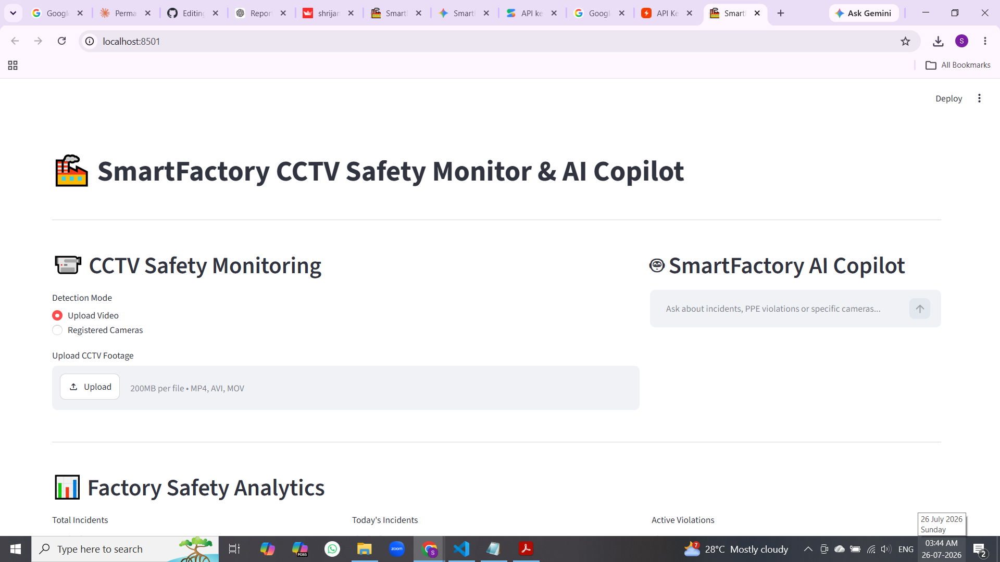

# 🏭 SmartFactory CCTV Safety Monitor & AI Copilot

[](https://www.python.org/)
[](https://streamlit.io/)
[](https://github.com/ultralytics/ultralytics)
[](https://github.com/roboflow/supervision)
[](https://www.trychroma.com/)
[](https://github.com/langchain-ai/langgraph)
[](https://groq.com/)
[](tests/)

An industrial safety intelligence platform combining computer vision (YOLOv8 + ByteTrack), relational incident tracking (SQLite), dual-collection semantic retrieval (ChromaDB), and an agentic copilot (LangGraph + Groq) to automate PPE compliance verification and workplace incident analysis.

---

## 📌 Problem Overview

Industrial workplaces—such as manufacturing plants, assembly facilities, and logistics warehouses—mandate strict Personal Protective Equipment (PPE) compliance (hard hats, safety vests, and masks) to protect workers from physical hazards. 

Common operational challenges include:
- **Detection Fatigue:** Safety supervisors cannot continuously monitor multi-camera CCTV feeds in real time.
- **Alert Saturation:** Raw frame-by-frame object detection triggers duplicate alert spam for a single ongoing violation.
- **Fragmented Incident Data:** Safety logs lack unified linkage between physical evidence (video snapshots), structured metadata (timestamps, zones, worker IDs), and procedural safety documentation.
- **Delayed Root-Cause Analysis:** Floor managers cannot easily query historical violations or correlate observed incidents against company Standard Operating Procedures (SOPs).

SmartFactory Copilot addresses these challenges by transforming passive CCTV footage into structured, searchable safety intelligence with contextual AI assistance.

---

## ✨ Key Features

- **Computer Vision PPE Detection:** Evaluates video frames using YOLOv8 (`models/best.pt`) at an optimized confidence threshold (`0.35`) to detect `no-hardhat`, `no-safety vest`, and `no-mask` events.
- **Multi-Object Worker Tracking & Deduplication:** Integrates ByteTrack via Roboflow `supervision` to maintain continuous worker trajectory IDs. A dedicated `ViolationTracker` aggregates continuous multi-frame detections into a single recorded incident per worker, closing alerts upon a configurable timeout (default 3s).
- **Relational Incident Persistence:** Logs every verified incident into SQLite (`events` table) with camera source, factory zone, worker ID, severity rating, detection confidence, start/end timestamps, snapshot image paths, and upload batch run identifiers.
- **Dual-Collection ChromaDB RAG:**
  - `factory_incidents` collection: Stores semantic event summaries indexed with stable, idempotent primary keys (`event_<sqlite_id>`).
  - `safety_sops` collection: Stores overlapping document chunks of standard operating procedures with source attribution.
- **Safety SOP Knowledge Base:** Ingests local workplace guidelines (`.txt` and `.pdf` files via PyMuPDF) into ChromaDB, allowing floor managers to query compliance protocols and corrective actions.
- **Deterministic Intent Routing + LangGraph ReAct Agent:**
  - Low-latency regex fast-paths route structured queries (SQL filters, dashboard metrics, SOP retrieval, PDF generation) directly without LLM token overhead.
  - Conversational queries fall back to a LangGraph ReAct agent armed with 4 discrete tools (`query_incidents_sql_tool`, `query_incidents_semantic_tool`, `query_sop_tool`, `get_stats_tool`) and session memory (`MemorySaver`).
- **Interactive Streamlit Dashboard:** Live dual-panel layout featuring video playback, detection telemetry, zone bar charts, camera metrics, severity distribution pie charts, 14-day trend lines, and repeat offender monitoring.
- **Executive PDF Reporting:** Generates downloadable EHS safety compliance briefs featuring 7-day trend metrics, zone breakdowns, and safety rating badges using FPDF2 and ReportLab.

---

## 🛠️ Technology Stack

| Category | Technologies | Description |
|---|---|---|
| **Computer Vision** | OpenCV, Ultralytics YOLOv8, Supervision | Video frame decoding, bounding box inference, ByteTrack multi-object association |
| **Data Storage** | SQLite 3, ChromaDB | Relational incident storage and vector space embedding store |
| **AI & Orchestration** | LangGraph, LangChain, Groq Cloud | ReAct agent loop, tool execution, Llama 3.1 8B (fast inference) & Llama 3.3 70B (reports) |
| **Embeddings & RAG** | ChromaDB Default (all-MiniLM-L6-v2), PyMuPDF | Text chunking, overlapping windows, semantic similarity matching |
| **Frontend & Visualization** | Streamlit, Plotly Express, Pandas | Reactive web dashboard, telemetry metrics, and interactive charts |
| **Document Generation** | FPDF2, ReportLab | Automated PDF generation for executive compliance reporting |
| **Configuration & Testing** | python-dotenv, pytest, pytest-asyncio | Environment management and automated test verification |

---

## 📐 System Architecture



---

## 🔄 End-to-End Data Flow

1. **Footage Ingestion:** Video footage (`.mp4`, `.avi`, `.mov`) is uploaded through the dashboard or loaded from registered camera sources.
2. **Detection & Association:** Every $N$-th frame (default skip = 3) is resized to $640\times360$ and fed to YOLOv8. Detections are converted to supervision structures and tracked across frames via ByteTrack.
3. **Violation Deduplication:** Active violations per worker are monitored by `ViolationTracker`. When a worker corrects their PPE or exits the field of view for $>3$ seconds, the incident is closed with calculated duration and maximum confidence.
4. **Dual Write:**
   - **SQLite:** Writes a row to `events` with `timestamp`, `camera`, `zone`, `worker_id`, `event`, `severity`, `confidence`, `start_time`, `end_time`, `image_path`, and `run_id`.
   - **ChromaDB (`factory_incidents`):** Creates a vector document keyed by `event_<sqlite_event_id>` ensuring idempotent upserts.
5. **Knowledge Querying & Dispatch:** User questions enter `IntentRouter`. Exact-match queries bypass LLMs for zero-latency responses; multi-step analytical queries trigger the LangGraph ReAct agent.
6. **Telemetry & PDF Delivery:** Live metrics render in Streamlit; EHS reports compile on demand to PDF.

---

## 🧠 Dual-Collection RAG Architecture

The platform separates factual incident logs from procedural guidelines into two isolated ChromaDB collections:

```
ChromaDB Persistent Store (database/chroma/)
├── Collection: "factory_incidents"
│   ├── Purpose: Grounding factual incident retrieval
│   ├── Document ID: event_<sqlite_event_id> (Idempotent)
│   ├── Embedding Text: "Worker 104 detected with violation 'no-hardhat' on camera 'Cam-01' in Zone A lasting 12s..."
│   └── Metadata: {camera, worker_id, zone, event, severity, confidence, timestamp, image_path}
│
└── Collection: "safety_sops"
    ├── Purpose: Grounding procedural compliance and corrective recommendations
    ├── Document ID: sop_<source_name>_chunk<index>
    ├── Embedding Text: 600-character overlapping chunks (100-char overlap) from safety guidelines
    └── Metadata: {source, category, chunk_index, total_chunks, document_type}
```

---

## 📁 Repository Structure

```
Smartfactory-CCTV-AI-Copilot-main/
├── app.py                      # Streamlit application entry point & dashboard layout
├── app_config.py               # Safe environment & Streamlit secrets configuration loader
├── requirements.txt            # Python dependencies with pinned versions
├── packages.txt                # System-level dependencies for container deployments
├── runtime.txt                 # Pinned Python runtime (3.11.9)
├── .env.example                # Template for environment variables (placeholders only)
├── .gitignore                  # Git exclusion rules for secrets, DBs, caches, and media
├── agents/
│   ├── __init__.py
│   ├── copilot.py              # LangGraph ReAct agent factory and ask() router pipeline
│   ├── database_api.py         # Structured SQLite query endpoints and metric aggregations
│   ├── report_writer.py        # Executive summary text generation
│   └── tools.py                # 4 LangChain @tool wrappers for agent execution
├── ai/
│   ├── __init__.py
│   ├── analytics_service.py    # Day-over-day delta comparisons and trend summaries
│   ├── insights_service.py     # Prescriptive operations recommendations
│   ├── intent_router.py        # Regex word-boundary keyword router (9 distinct intents)
│   ├── llm.py                  # Lazy LLMManager for Groq Cloud models
│   ├── report_service.py       # ReportLab PDF compilation service
│   ├── report_writer.py        # AIReportWriter: Groq Llama 3.3 70B + ReportLab pipeline
│   ├── risk_service.py         # Operational threat assessment engine
│   ├── semantic_search_service.py # Vector search interface for factory_incidents
│   ├── sql_parser.py           # Natural-language-to-SQL filter parameter extractor
│   └── utils.py                # Formatting and text normalization helpers
├── cctv/
│   ├── __init__.py
│   ├── incident_pipeline.py    # Incident closure, SQLite write, and vector ingestion
│   ├── multi_camera_runner.py  # Database-driven multi-feed batch execution engine
│   ├── safety_engine.py        # YOLO model wrapper, classes, and check() classifier
│   ├── snapshot.py             # Evidence capture saving frame images to assets/incidents/
│   ├── stream.py               # VideoCapture frame generator
│   ├── tracker.py              # ByteTrack supervision tracker wrapper
│   └── violation_tracker.py    # Per-worker violation lifecycle and deduplication manager
├── database/
│   ├── __init__.py
│   └── db.py                   # SQLite schema initialization, migrations, and connections
├── knowledge_base/
│   └── safety_sops/            # Demonstration safety standard operating procedures
│       ├── helmet_safety.txt   # Head protection procedures, inspection checklist, escalation
│       ├── ppe_compliance.txt  # Core PPE mandates, disciplinary steps, and supervisor duties
│       └── workplace_safety.txt# Zone definitions, hazard classification, and LOTO standards
├── models/
│   ├── best.pt                 # Fine-tuned YOLOv8 PPE detection model weights
│   └── detector.py             # Helper module for standalone frame inference
├── rag/
│   ├── __init__.py
│   ├── ingest.py               # ChromaDB factory_incidents ingestion and collection access
│   └── sop_ingest.py           # SOP document ingestion (TXT/PDF), chunking, and search
├── reports/
│   └── generate_report.py      # FPDF2-based executive safety PDF generation
├── tests/
│   ├── test_unit.py            # 40 comprehensive unit tests with isolated SQLite and mocks
│   ├── test_config_and_startup.py # 9 configuration, secrets, and startup tests
│   └── test_*.py               # Integration test scripts
├── ui/
│   └── dashboard.py            # Standalone modular telemetry interface components
└── assets/                     # UI visual documentation screenshots
```

---

## 🚀 Setup & Installation

### 1. Prerequisites
- **Python 3.11** (recommended; tested on Python 3.11.9)
- **Git**
- A **Groq Cloud API Key** (free tier available at [console.groq.com](https://console.groq.com))

### 2. Clone the Repository
```bash
git clone https://github.com/your-username/SmartFactory-CCTV-AI-Copilot.git
cd SmartFactory-CCTV-AI-Copilot-main
```

### 3. Create & Activate a Virtual Environment

**Windows (PowerShell):**
```powershell
python -m venv venv
.\venv\Scripts\Activate.ps1
```

**macOS / Linux:**
```bash
python3 -m venv venv
source venv/bin/activate
```

### 4. Install Dependencies
```bash
pip install --upgrade pip
pip install -r requirements.txt
```

---

## ⚙️ Configuration

1. Copy the example environment file:
   ```bash
   cp .env.example .env
   ```
2. Open `.env` in a text editor and add your Groq API key:
   ```env
   GROQ_API_KEY=gsk_your_actual_groq_key_here
   ```

*(Optional)* If deploying via Streamlit Community Cloud or local Streamlit secrets, configure `.streamlit/secrets.toml`:
```toml
GROQ_API_KEY = "gsk_your_actual_groq_key_here"
```

> **Note:** The application starts and runs cleanly even if `GROQ_API_KEY` is not provided. CCTV video detection, multi-camera processing, SQLite analytics, Plotly charts, and deterministic SQL/SOP queries remain operational. AI conversational features gracefully prompt for configuration.

---

## 🗄️ Database Initialization & SOP Ingestion

### Initialize SQLite Database
The SQLite database (`database/factory.db`) auto-initializes on application boot. You can also trigger initialization manually:
```bash
python -c "from database.db import init_db; init_db()"
```

### Ingest Safety SOP Documents
Populate the `safety_sops` ChromaDB collection with the bundled demonstration safety documentation:
```bash
python -m rag.sop_ingest
```
Expected output:
```text
INFO — Ingested helmet_safety.txt — 12 chunks
INFO — Ingested ppe_compliance.txt — 8 chunks
INFO — Ingested workplace_safety.txt — 15 chunks
✅ SOP ingestion finished. Total chunks stored: 35
```

---

## 💻 Running the Application

Launch the Streamlit web dashboard:
```bash
streamlit run app.py
```

Once running, navigate to:
- **Local URL:** `http://localhost:8501`
- **Network URL:** Displayed in the terminal output

---

## 💬 Example Copilot Prompts

| Query Type | Example Prompt | Handler Path |
|---|---|---|
| **SQL Incident Query** | *"How many PPE violations occurred today?"* | Deterministic SQL Parser |
| **Filtered Incident Query** | *"Show me all high severity helmet violations in Zone A"* | Parameterized SQL query |
| **Worker Lookup** | *"List violations involving worker 104"* | Parameterized SQL query |
| **Dashboard Metrics** | *"Show factory dashboard"* | Cached system stats |
| **Incident Context** | *"Explain recent incidents in the loading dock"* | ChromaDB `factory_incidents` RAG |
| **Safety Procedures** | *"What is the helmet replacement schedule?"* | ChromaDB `safety_sops` RAG |
| **Corrective Protocols** | *"What corrective actions apply to a repeat vest violation?"* | ChromaDB `safety_sops` RAG |
| **Day-over-Day Trends** | *"Compare today vs yesterday"* | Analytics day-over-day delta engine |
| **Threat Assessment** | *"What are the high risk operational hazards?"* | Risk threat evaluation engine |
| **Executive Reporting** | *"Generate safety report"* | AI Report Writer + PDF export |

---

## 🧪 Testing & Verification

The repository contains an automated test suite that executes locally without requiring active network connectivity, paid API tokens, GPU drivers, or video files.

Run the complete test suite:
```bash
python -m pytest tests/test_unit.py tests/test_config_and_startup.py -v
```

### Verified Test Status: **49 Passed / 0 Failed**

```text
tests/test_unit.py::TestSaveEvent (3 tests) ...................... PASSED
tests/test_unit.py::TestGetStats (2 tests) ....................... PASSED
tests/test_unit.py::TestViolationTracker (4 tests) ............... PASSED
tests/test_unit.py::TestIntentRouter (8 tests) ................... PASSED
tests/test_unit.py::TestSQLParser (6 tests) ...................... PASSED
tests/test_unit.py::TestChromaIngestion (4 tests) ................ PASSED
tests/test_unit.py::TestSemanticSearchService (3 tests) .......... PASSED
tests/test_unit.py::TestSOPRetrieval (2 tests) ................... PASSED
tests/test_unit.py::TestSOPChunking (4 tests) .................... PASSED
tests/test_unit.py::TestQueryIncidentsSQL (4 tests) .............. PASSED
tests/test_config_and_startup.py::TestAppConfig (4 tests) ........ PASSED
tests/test_config_and_startup.py::TestCopilotImportAndAsk (5 tests) PASSED

============================= 49 passed in 0.86s =============================
```

---

## 📸 Screenshots

| View | Preview |
|---|---|
| **Real-Time Video Detection** |  |
| **AI Copilot Chat Interface** |  |
| **Safety Analytics & Heatmap** |  |
| **Live Telemetry Scorecards** |  |
| **Executive Command Center** |  |

*(To update or customize screenshots, replace the corresponding PNG files in the `assets/` folder.)*

---

## ⚠️ Known Limitations & Future Roadmap

### Current Scope & Known Limitations
1. **Video Ingestion:** Processes recorded video uploads (`.mp4`, `.avi`, `.mov`) and local simulated camera video paths. Live network RTSP stream decoding is not implemented.
2. **Zone Mapping:** Zone allocation for single uploaded video files defaults to `Zone A`. Multi-zone association is configured via registered camera table entries.
3. **Demonstration Safety Guidance:** Bundled documents in `knowledge_base/safety_sops/` are demonstration guidelines designed for retrieval validation, not certified OSHA/regulatory documentation.
4. **Authentication:** The dashboard is currently single-tenant and does not enforce multi-user role-based access control (RBAC).

### Future Roadmap
- [ ] Implement asynchronous multi-threaded RTSP video stream ingest with reconnect backoff.
- [ ] Add visual polygon-based zone boundary drawing directly within the Streamlit UI.
- [ ] Ingest live SOP PDFs directly from the dashboard UI with automatic ChromaDB re-indexing.
- [ ] Integrate automated email/Slack webhook dispatch upon repeated high-severity violations.
- [ ] Add worker facial/badge re-identification to persist worker profiles across cameras.

---

## 📄 License

This repository is maintained as an engineering demonstration and portfolio project. 

*No commercial open-source license has been formally applied. Inquire directly with the project owner prior to commercial re-distribution.*
